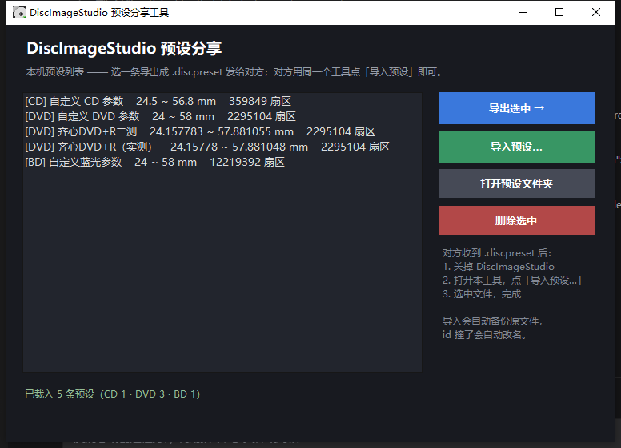

# DiscImageStudio 预设分享工具

**v0.1.0** · 制作：DeepSeek Harness

一个免安装的 Windows 小工具，用来**导出 / 导入 [Disc Image Studio](https://github.com/JiaFeiMiao-K-Cat/DiscImageStudio) 的盘片预设**。

把自己辛苦标定出来的参数打包成一个 `.discpreset` 文件发给别人，对方双击导入就能用，不用再手动抄那一堆数（内半径、外半径、扇区数、轨距系数……）。

## 下载

👉 **[⬇ 下载最新版](https://github.com/XiaoPengqwq/DiscImageStudio-PresetTool/releases/latest)**

免安装，双击即用。需要 .NET Framework 4.x（Windows 10 / 11 自带）。



---

## 为什么需要它

Disc Image Studio 的预设全存在每台机器自己的一个 JSON 里：

```
%LOCALAPPDATA%\DiscImageStudio\disc-presets.json
```

想分享给朋友只能手动复制粘贴，字段一多就容易抄错，`id` 撞了还会互相覆盖。这个工具把这套流程做成一键：**导出成文件 → 对方导入**。

## 支持范围

预设文件里其实有**三种**盘，工具全都认：

| 类型 | 字段键名 | 特有字段 |
| --- | --- | --- |
| CD | `cdPresets` | `sectors`、`linearVelocityMmPerSecond` |
| DVD | `dvdPresets` | `totalSectors`、`channelBitLengthNm`、`usableSectors` |
| 蓝光 BD | `bluRayPresets` | `totalSectors`、`invertMapping` |

导入时会按文件里的 `discType` 自动写回**对应的那一组**，不会把 CD 预设塞进 DVD 列表里。旧版工具导出的文件（`kind: discimagestudio-dvd-preset`，没有 `discType`）也能读，按 DVD 处理，或者按字段自动判断。

---

## 功能

| 功能 | 说明 |
| --- | --- |
| 列出预设 | 读出本机全部 CD / DVD / BD 预设，前面标类型，显示半径与扇区数 |
| 导出选中 | 生成 `.discpreset`（JSON 包装格式，见下文） |
| 导入预设 | 合并到本机对应类型，**自动备份**原文件，`id` 冲突自动加后缀 |
| 单实例 | 重复打开不会开第二个窗口，只会把已经在跑的那个顶到前面 |
| 删除选中 | 弹窗二次确认（是 / 否），删除前自动备份 |
| 打开预设文件夹 | 已在资源管理器里打开就切过去，不会越点越多 |

---

## 用法

1. 解压或直接双击 `DiscImageStudio预设工具.exe`（免安装）
2. 列表里点一条预设（左边方括号里是盘类型）
3. 点 **导出选中 →**，选个位置保存
4. 把那个 `.discpreset` 发给别人

对方那边：

1. 也打开这个工具
2. 点 **导入预设…**，选中 `.discpreset`
3. 列表里多出一条，进 Disc Image Studio 就能在预设下拉里看到

> 导入会先备份一次原 `disc-presets.json`（`.bak-yyyyMMdd-HHmmss`），出问题可以直接改名还原。

---

## .discpreset 格式

就是个 UTF-8 的 JSON 文件，方便人肉检查或手改：

```json
{
  "kind": "discimagestudio-preset",
  "formatVersion": 2,
  "exportedFrom": "DESKTOP-XXXXXXX",
  "exportedAt": "2026-11-13 17:24:02",
  "discType": "CD",
  "preset": {
    "id": "user-custom-cd",
    "displayName": "自定义 CD 参数",
    "description": "用户预设，可直接修改或复制后添加更多 CD 参数。",
    "sectors": 359849,
    "innerRadiusMm": 24.5,
    "outerRadiusMm": 56.8,
    "linearVelocityMmPerSecond": 1200,
    "pitchLinear": 0,
    "pitchQuadratic": 0,
    "pitchCubic": 0
  }
}
```

DVD / BD 的 `preset` 换成对应字段即可。`id` 撞车时导入端会自动改成 `原id-dup123` 之类，不会覆盖你已有的预设。

---

## 从源码编译

只需要 Windows 自带的 .NET Framework 4.x 编译器，没有 NuGet、没有外部依赖。

```powershell
.\build.ps1
```

或者手动：

```bat
C:\Windows\Microsoft.NET\Framework64\v4.0.30319\csc.exe ^
  /nologo /target:winexe /codepage:65001 ^
  /win32icon:assets\DiscImageStudio导出工具.ico ^
  /r:System.Windows.Forms.dll /r:System.Drawing.dll ^
  /r:System.Web.Extensions.dll /r:Microsoft.CSharp.dll ^
  /out:dist\DiscImageStudio预设工具.exe ^
  src\PresetTool.cs
```

编译产物约 61 KB，单文件，无依赖。

---

## 目录结构

```
DiscImageStudio-PresetTool/
├─ src/PresetTool.cs                全部源码（单文件）
├─ assets/                           图标（16/32/48/64/128/256 png + ico）+ 界面截图
├─ dist/DiscImageStudio预设工具.exe  编译好的成品
├─ build.ps1                         一键编译
├─ README.md
└─ LICENSE
```

---

## 说明

- 工具**完全不联网**，只读写本地 `disc-presets.json`，不碰光盘、不碰光驱。
- 它处理和 Disc Image Studio 同一份预设文件，所以两边可以同时用。
- 导入前一定备份，出问题能退回去。

---

## 关于开发方式

**这个工具是 AI 写的。**

从界面布局、单实例处理、图标嵌入，到 CD/DVD/BD 三类预设的读写与合并逻辑，整套代码由 AI 编程助手在 **DeepSeek Harness** 里完成；人类负责提需求、验收、试错和拍板（比如「为什么只支持 DVD」「重复打开别开新窗口」这些都是人提出来的）。

所以：

- 源码风格可能和手写项目不太一样，注释密度偏高
- 有任何 bug 尽管开 issue，改起来也快

工具链：[DeepSeek Harness](https://github.com/deepseek-ai) 的 Agent 模式。

版本信息也写进了 exe 本身（右键 → 属性 → 详细信息）：

| 字段 | 值 |
| --- | --- |
| 文件说明 | DiscImageStudio 预设分享工具 |
| 产品名称 | DiscImageStudio Preset Tool |
| 公司 | DeepSeek Harness |
| 文件版本 | 0.1.0.0 |
| 产品版本 | 0.1.0.0 |
| 版权 | MIT License |

## 致谢

- [Disc Image Studio](https://github.com/JiaFeiMiao-K-Cat/DiscImageStudio) —— 盘面标定的本体程序
- 图标基于原程序图标修改（加了循环箭头），如原作者有异议会立刻更换

## 许可

MIT，见 [LICENSE](LICENSE)。
